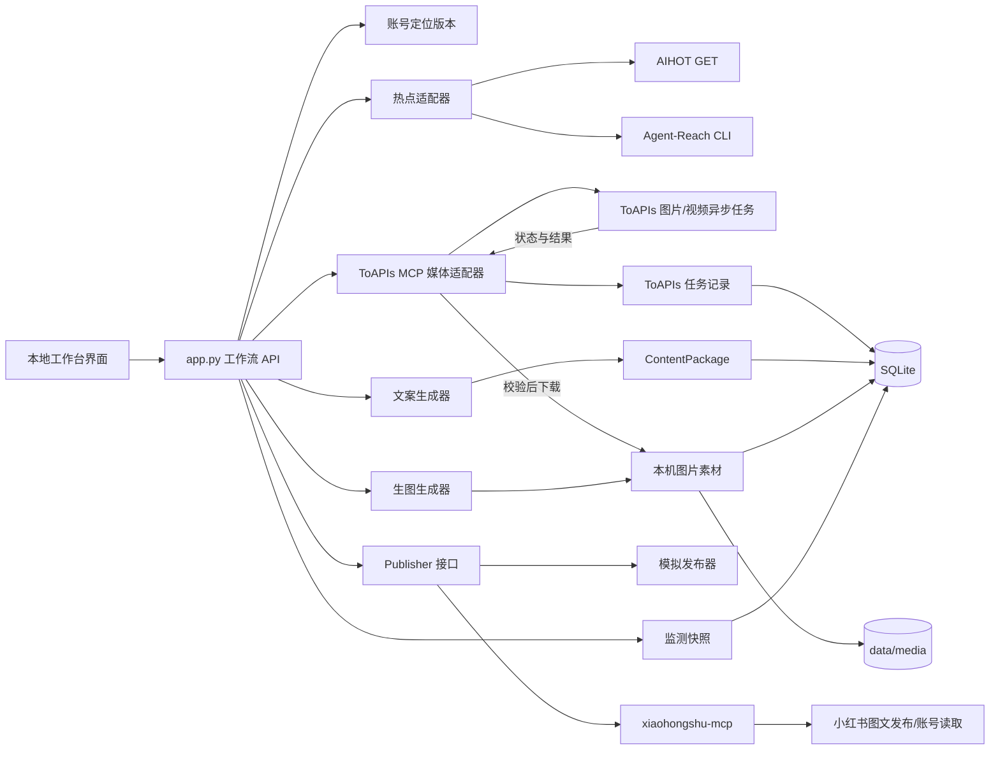

# 小红书工作台架构

- 版本：0.5
- 状态：图文 MVP、ToAPIs 图片/视频生成与多模型文案配置已实现，待实机验收
- 日期：2026-11-09
- 对应需求：[PRD.md](PRD.md)

## 1. 架构目标

当前阶段先以一个本机进程跑通图文制作和发布，同时保留账号监测、发布记录等独立页面。采用模块化单体：一个 HTTP 服务、一个 SQLite 数据库和一个本机素材目录。暂不引入微服务、Redis 或远程任务队列。

扩展边界：热点来源、文本/图片生成器、素材存储和发布连接器可分别替换；一个模块变化不应要求其他模块了解供应商细节。

## 2. 组件与数据流



核心图文流水线：

```text
账号定位 → 主动扫描热点 → 人工选择参考 → 文案草稿 → 人工编辑
        → 主动请求生图 → 选择本机图片 → 图文预览 → 明确确认 → 发布与核验
```

每一步由用户触发或确认。来源数据不会绕过编辑直接发布；生图不会自动开始；发布结果不由生成模型推断。

## 3. 模块边界

### 工作台界面与工作流 API

`web/` 提供账号定位、内容制作、账号监测、发布记录、服务设置五个页面。`app.py` 校验输入、读取当前定位和设置、调用适配器并存储结果。界面不直接访问 MCP、模型 API 或数据库。

### 账号与定位

`workbench/store.py` 管理单个 `Account` 和版本化 `PersonaProfile`。任务保存当前定位版本。工作台定位与 MCP 当前登录账号身份分开；发布前由操作者核对。

### 热点来源

`workbench/trends.py` 把不同只读来源整理成统一热点项：来源、标题、URL、摘要、作者、发布时间和抓取时间。

- AIHOT 只发 HTTPS GET 到 `aihot.news`，读取 `hot`、`latest`、`search` 接口，并解析服务返回的 Markdown。
- Agent-Reach 通过 `subprocess.run(..., shell=False)` 调用，命令参数不经过 shell。默认渠道按安装状态尝试；Reddit/X 使用公开网页后端。
- 任一来源失败作为独立来源状态返回，不阻断其他来源。用户选择的内容才会放进文案生成请求。
- 热点扫描是一次性搜索，不是定时监控、全网覆盖、热点排序保证或完整内容归档。

外部来源文本均视为不可信数据，提示词要求忽略其中的命令或指令。解析器只读取允许的字段，不执行来源内容。

### 文案生成器

`workbench/generators.py` 的生成器适配 OpenAI 兼容 Chat Completions 和 Responses API，路由器按用户配置的方案顺序选用模型。方案元数据和顺序保存在应用设置；最多 8 套方案，每套的 API Key 只放在当前进程内存。DeepSeek、通义千问、OpenAI、AixHan 提供接口地址预设，自定义方案可指定兼容地址与协议。每次生成默认先调用列表首位；开启自动切换后，仅在 HTTP 429 限流时依次尝试后续已配置 Key 的方案。其他服务错误、连接中断、超时或响应格式异常不会重发，避免结果不确定时重复计费。单方案测试会关闭备用路由。生成器不核实事实，不操作发布器；请求不跟随 HTTP 重定向，避免向其他地址转发 API Key。

### 生图生成器和素材

`workbench/images.py` 调用 OpenAI 兼容 `images/generations` 接口并要求 `b64_json` 响应；不下载远程图片 URL，也不跟随重定向。图片经过 MIME/文件签名检查后写入 `data/media`，素材元数据进入 SQLite。界面允许选择最多 9 张图用于笔记。

### ToAPIs 媒体生成

`workbench/toapis.py` 使用官方 Streamable HTTP MCP 工具读取模型、余额和参数说明，并提交图片/视频生成任务。工作台为每次生成创建唯一 `client_request_id`，保存任务编号、状态、模型和素材 ID；轮询与请求超时恢复使用同一编号，避免因浏览器断线重复提交。MCP session 在一次操作结束后尝试关闭。

生成完成后，适配器只下载返回的 HTTPS 媒体链接。下载前检查 DNS 所有地址均为公网地址，并将实际 TLS 连接固定到已校验的 IP；仅允许标准 HTTPS 端口，重定向目标也会重新验证。下载限制图片 25 MB、视频 1 GB，并按 MIME 与文件签名验证格式。结果 URL 不保存到 SQLite。下载失败保留任务 ID，用户可重新查询并只重试下载，不会重提生成任务。图片结果进入现有图片列表，视频可在页面预览和下载；该功能不提供视频剪辑或独立发布流程。

### 内容包与存储

`ContentPackage` 保存账号定位版本、内容类型、主素材 ID、多素材 ID 列表、标题、正文、话题、来源引用和内容指纹。图文笔记通过 `content_type=note` 与多个图片 `asset_ids` 表示；视频历史记录的默认类型和单素材兼容逻辑保留。

SQLite 元数据和本机媒体文件分开保存。API Key 只放在运行时内存，不写入数据库。监测快照使用字段白名单，过滤 Cookie、Token 等敏感字段。

文案模型设置以 `generator_profiles_json` 保存不含密钥的方案数组，并单独记录 `generator_auto_fallback`。方案数组的顺序就是首选及备用顺序。保存配置时，只有当前编辑方案的新 Key 会更新该方案的运行时密钥；任何方案更换服务商或接口地址时都会清除旧 Key。旧版 `generator_model` 等单模型设置在启动时迁移为一套方案，且旧版环境变量 Key 绑定到这唯一的迁移方案；显式空数组表示用户已删除所有方案，不会恢复旧配置。新版多方案中，环境变量 Key 只应用于接口地址和模型 ID 均匹配的方案。

ToAPIs 站点区域会保存为普通设置，API Key 仅在进程内存。生成记录 API 不返回媒体文件的本机绝对路径。

### 发布器与任务状态

`workbench/publishers.py` 暴露统一发布接口。图文 MCP 适配器调用 `publish_content`，参数为 `title`、`content`、`images`（本地图片路径列表）和 `tags`。显式 `content_type=video` 仍调用旧 `publish_with_video` 分支，以维持历史兼容，但不作为当前 UI 流程。

模拟发布器只返回本地模拟状态。MCP 返回可识别的提交说明会进入 `submitted`，操作者仍需去小红书检查。超时或响应含糊进入 `unknown_manual_check`，系统不会自动重发。内容指纹和发布器 ID 用于阻止不确定结果下重复提交。

MCP 地址只允许 localhost/loopback。小红书登录会话由独立 MCP 服务管理；工作台不读写 Cookie，也不自动登录。

### 账号监测

监测模块只读调用 MCP 登录状态和当前主页数据，并保存快照。指标按连接器实际响应展示，不生成播放量或完整历史内容推断。前端在监测页打开时按 30 分钟间隔刷新。

## 4. 领域对象

```text
Account
  id, display_name, configured, current_profile_version

PersonaProfile
  account_id, version, content_lane, positioning, audience, tone,
  structure, boundaries, fact_rules, preferred_topics

Asset
  id, media_type(image|video), local_path, mime_type, size, sha256

TrendItem
  source, title, url, summary, author, published_at, fetched_at

ContentPackage
  account_id, persona_version, content_type(note|video), asset_id,
  asset_ids[], title, body, tags[], source_refs[], fingerprint

PublishJob / PublishAttempt
  id, publisher_id, status, idempotency_key, result, verification_note

ToAPIsGeneration
  client_request_id, media_type, model, state, task_id, asset_id, error_text

MonitorSnapshot
  observed account fields, allowlisted metrics, loaded note summaries
```

## 5. 接口契约

```text
TrendSource.scan(query, selected_channels) -> SourceResult[]
ContentGenerator.generate(profile, idea, brief, source_refs) -> Draft
ImageGenerator.generate(prompt, size) -> (image_bytes, mime_type)
ToAPIsMedia.list_models/get_balance/get_model_docs(model)
ToAPIsMedia.generate(media_type, model, params, client_request_id) -> Generation
ToAPIsMedia.get_generation(client_request_id) -> Generation
Publisher.validate(request) -> ValidationResult
Publisher.publish(request, idempotency_key) -> PublishResult
Publisher.read_account_snapshot() -> MonitorSnapshot
```

适配器向工作流返回标准字段，不把 Cookie、签名参数、模型密钥或浏览器对象传入任务记录。新增来源时遵守只读约束并返回可追溯 URL 和来源状态；新增内容形态时扩展素材类型和发布请求，不把平台专属参数放进通用界面状态。

## 6. 部署与安全

- 本地 HTTP 服务绑定 `127.0.0.1`；写请求只接受本机来源。
- SQLite、媒体文件均留在配置的数据目录。
- 文案、生图和 ToAPIs Key 仅在运行期间存在于内存；文案和生图模型请求禁止跟随重定向。
- ToAPIs Key 仅在运行期间存在于内存；媒体下载固定到已验证公网 IP，并检查每个重定向目标。
- AIHOT 适配器仅向 AIHOT 域名发 GET；Agent-Reach 仅用于只读搜索。
- 不绕过登录、安全校验、验证码、访问限制或平台风控。
- AIHOT 面向外部商业用途需事先取得服务方书面授权；见 <https://aihot.news/terms>。

## 7. 后续扩展顺序

1. 实机核验热点、文案、生图和图文发布链路，并记录各来源的真实可用状态。
2. 增加来源缓存、去重和新鲜度提示，仍由用户主动触发或明确开启。
3. 独立设计多账号与定位隔离，不能依赖共享 MCP 登录态推断账号身份。
4. 只有在平台和账号权限允许时，再评估视频剪辑、定时流程或官方授权发布接口。
